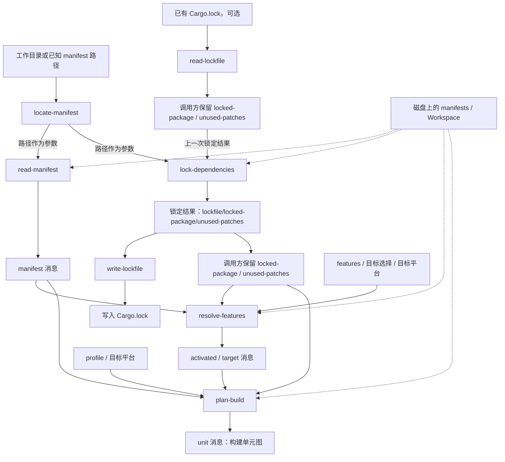
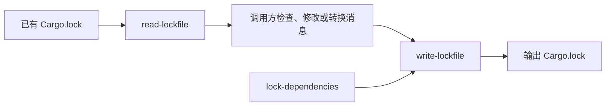
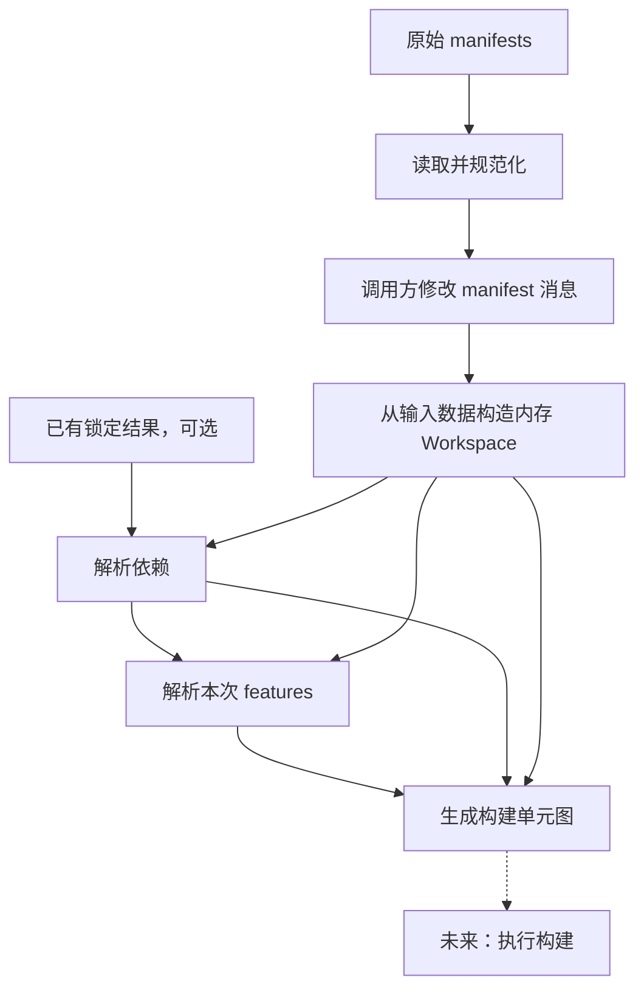

# cargo-plumbing 仓库运转与命令流程

本文面向熟悉 Rust 和日常 Cargo 使用、
希望理解并参与 cargo-plumbing 的开发者。

核对日期：2026-10-13。
实现说明以本地 `dev` 分支的 `bc6f84d` 为基准；
`roundtrip`、`fix-replace` 两个已提交 PR 的分支改动单独说明，
不视为当前基线已有能力。
本文依据源码说明职责和数据流，
没有宣称所有示例或完整流程已经运行验证。

## 1. 这个仓库要做什么

通常执行 `cargo build` 时，
Cargo 帮我们完成项目读取、依赖解析、feature 解析、
构建规划和编译执行。
调用方主要通过命令行参数控制整个过程。

cargo-plumbing 希望将其中的步骤暴露为可单独调用的命令，
让外部工具读取、保存、修改、组合中间数据。
例如，一个工具可以读取项目声明，修改参与解析的依赖，
再让 Cargo 完成后续解析；
外部构建系统也可以利用 Cargo 的分析结果安排自己的工作。

本仓库是实验性的第三方 Cargo 子命令，
调用形式为 `cargo plumbing <命令>`。
目前已有七个命令，构建执行命令尚未完成。
它本身仍使用普通 Cargo workspace 构建；
参与开发不要求先掌握其他构建系统。

这里需要区分两件事：

- **已有能力**：通过 JSON Lines 消息暴露部分中间结果，
  组合读取、解析和规划步骤。
- **尚未完整实现的目标**：后续阶段完全消费调用方提供的 manifest 数据，
  修改消息就能改变解析行为，无需重新读取原始 manifest。

## 2. 先区分几种数据

| 数据              | 例子                                     | 含义                                     |
| ----------------- | ---------------------------------------- | ---------------------------------------- |
| Manifest 声明     | `foo = "1"`                              | 项目要求什么，可能允许多个版本           |
| 锁定结果          | `foo 1.2.0` 及其来源、依赖关系、checksum | 这次解析具体选择了什么                   |
| Lockfile 格式版本 | V1、V2、V3、V4                           | 如何将锁定结果编码为文件，与包的版本无关 |
| Feature 解析结果  | 某包在 host 或目标侧启用哪些 features    | 针对本次操作的功能选择                   |
| 构建单元图        | 哪些编译单元依赖哪些其他单元             | 后续执行所需的工作关系                   |

同一个包可能因 host/target、target 类型、profile 等因素
参与不同构建单元。
因此，锁定的 package 图不等于某一次构建的 unit graph。

此外，Rust 中的 `target` 在这里有两种常见含义：
lib/bin/example/test 等编译目标，
以及 `--target` 指定的目标平台 triple。
阅读命令参数时要区分二者。

## 3. 当前命令间的数据流

下面画的是当前接口所支持的主要编排关系。
实线表示路径参数或结构化消息的流向；
虚线表示额外的磁盘读取。
箭头不表示可以直接使用 shell 管道，筛选与合并由调用方负责。



这张图有几个关键点：

1. **读取 manifest 和读取旧 lockfile 是两个输入来源。**
   前者表达当前项目要求，后者表达之前的选择。
2. **首次解析可以没有旧 lockfile。**
   此时跳过 `read-lockfile`，
   给 `lock-dependencies` 提供空的标准输入并结束输入。
3. **写文件是锁定结果的一条输出分支。**
   后续命令的输入接口接收锁定消息，
   不要求调用方先写文件再读回来；
   当前 Cargo 内部调用仍可能访问文件系统。
4. **`resolve-features` 不会把所有输入原样转发。**
   调用方必须保留 manifest 和锁定消息，
   供 `plan-build` 再次使用。
5. **`plan-build` 输出图，不执行编译。**
   当前七个命令中没有消费 unit 消息并完成构建的执行命令。

`locate-manifest` 用来定位 manifest。
已经知道正确路径的调用方可以跳过它。
定位到某个 manifest，
也不应直接等同于已经发现了全部 workspace 成员。

## 4. 七个命令分别负责什么

| 命令                | 当前主要输入                                                                        | 输出                                                | 说明                                                       |
| ------------------- | ----------------------------------------------------------------------------------- | --------------------------------------------------- | ---------------------------------------------------------- |
| `locate-manifest`   | 当前目录或 `--manifest-path`                                                        | `manifest-location`                                 | 输出 manifest 的位置                                       |
| `read-manifest`     | `--manifest-path`，可选 `--workspace`                                               | `manifest`                                          | 读取 Cargo 规范化后的 manifest；`--workspace` 读取根及成员 |
| `read-lockfile`     | `--lockfile-path`                                                                   | `lockfile`、`locked-package`、可选 `unused-patches` | 读取已有文件，不重新选择依赖版本                           |
| `lock-dependencies` | 磁盘 Workspace；stdin 中可选的旧 `locked-package`、`unused-patches`                 | `lockfile`、`locked-package`、可选 `unused-patches` | 结合项目要求与已有锁定结果解析依赖                         |
| `write-lockfile`    | stdin 中的 `lockfile`、`locked-package`、`unused-patches`；输出路径                 | 写入文件，无业务 JSON 输出                          | 编码已有结果，不进行依赖求解                               |
| `resolve-features`  | `manifest`、锁定包/patch 消息；feature、目标和平台参数；磁盘 Workspace              | `activated`、`target`                               | 解析本次操作的 features 和目标选择                         |
| `plan-build`        | `manifest`、锁定包/patch、`activated`、`target`；profile 和平台参数；磁盘 Workspace | `unit`                                              | 生成构建单元及依赖关系                                     |

`read-manifest` 不带 `--workspace` 时，
如果读取的是 workspace 成员，
还可能额外输出 workspace 根 manifest，
因此不能假定一次调用只产生一条消息。
虚拟根 manifest 没有 package ID，消息中的 `pkg_id` 可以为空。

`read-manifest` 读取的是指定项目或 workspace 的 manifest，
不代表它已经输出所有 registry/git 依赖包的 manifest。

### 4.1 `read-lockfile` 为什么不是多余的

假设 `Cargo.toml` 声明 `foo = "1"`，
已有 lockfile 锁定 `foo 1.2.0`，
而 registry 又发布了 `1.3.0`。

如果要保持正常构建的依赖稳定性，
resolver 需要知道之前选择了 `1.2.0`。
`read-lockfile` 把这条信息交给调用方，
再由调用方传给 `lock-dependencies`。
只要旧结果仍满足当前约束，解析时就可以尽可能保留它；
新增依赖或不再满足约束的依赖则需要进一步求解。

旧结果是解析的依据，不意味着所有输入都会被无条件接受，
也不意味着这个过程就是“全部更新到最新版”。

### 4.2 `write-lockfile` 的输入不只来自 resolver

`read-lockfile` 和 `lock-dependencies` 都输出锁定结果消息，
二者都可以成为 writer 的上游。
调用方也可以构造符合输入契约的消息。



这张图表达接口上的组合关系。
现有 writer 对历史格式和部分字段的支持仍有缺口，
不能据此认为所有旧文件都能完整无损往返。

读写往返可以用于检查信息是否丢失；
补齐多版本编码后，
还可以在不重新选择包版本和 commit 的前提下转换文件格式。
输入格式版本来自 `lockfile` 消息，
当前没有单独的 writer CLI 格式版本参数。

## 5. 消息协议：Rust enum 通过 JSON Lines 传递

命令的业务输出采用 JSON Lines：每行一条完整 JSON 消息，
使用 `reason` 区分消息类型。
可以将其理解为跨进程传递的 Serde tagged enum。

下面是锁定结果的一个最小消息示意：

```jsonl
{"reason":"lockfile","version":4}
{"reason":"locked-package","id":"demo@0.1.0"}
```

`lockfile.version` 描述目标文件格式，不是 JSON 协议版本。
`locked-package` 携带包标识，
并按需包含 Git commit、checksum、dependencies 和 replace 等字段。

对于 Git 包，还要区分 manifest 请求的 branch/tag/rev
与解析后锁定的精确 commit；
消息模型将精确 commit 放在单独的 `rev` 字段中。

### 5.1 为什么不能把所有 stdout 直接传给下一个命令

每个命令使用独立的输入 enum，只接受它声明的消息变体。

| 上游数据                           | 下游                | 调用方需要做什么                                         |
| ---------------------------------- | ------------------- | -------------------------------------------------------- |
| `read-lockfile` 输出               | `lock-dependencies` | 保留 `locked-package`、`unused-patches`；不传 `lockfile` |
| `lock-dependencies` 输出           | `write-lockfile`    | 这些输出消息类型均属于 writer 的输入类型                 |
| 锁定结果 + manifest                | `resolve-features`  | 从锁定结果中移除 `lockfile`，合并 manifest 消息          |
| 锁定结果 + manifest + feature 结果 | `plan-build`        | 移除 `lockfile`，合并其余三类所需数据                    |

因此，下面仅是表达职责的伪代码，不是可以直接执行的 shell 脚本：

```text
manifests = read_manifest(manifest_path)
previous = read_lockfile(lockfile_path) if 文件存在 else []
previous_packages = select(
    previous, locked-package, unused-patches,
)

locked = lock_dependencies(
    manifest_path, stdin=previous_packages,
)

if 调用方需要保存:
    write_lockfile(output_path, stdin=locked)

packages = select(locked, locked-package, unused-patches)
features = resolve_features(
    manifest_path,
    stdin=concat(manifests, packages),
    feature_options,
    target_options,
)
units = plan_build(
    manifest_path,
    stdin=concat(manifests, packages, features),
    profile,
    target_platform,
)
```

这里的 `concat` 表示合并完整消息序列，并以换行分隔每条消息。
manifest 路径仍作为参数传给后续命令，
反映当前的磁盘 Workspace 依赖。

调用方还应检查子进程退出状态，
避免将失败阶段的部分输出当成完整结果；
输出了几条合法 JSON 并不表示整个命令已经成功。

### 5.2 当前消息读取器的限制

schema crate 中的 `MessageIter`
会把反序列化失败变成迭代返回 `None`。
普通 `for`/`collect` 消费因此会提前停止，
后面的合法消息也可能不再被读取。

这不是“自动忽略不认识的消息并继续”。
当前编排应显式筛选消息类型，不能依赖宽容解析。
如何处理未知消息涉及协议演进，是另一项设计工作。

## 6. 当前实现与完整 plumbing 目标的差距

当前 `lock-dependencies` 的 stdin **没有 manifest 消息变体**。
它用 `Workspace::new` 读取磁盘上的项目，
stdin 主要用于输入之前的锁定结果。

`resolve-features` 和 `plan-build` 虽然接受 manifest 消息，
但仍重新构造磁盘 Workspace。
它们使用输入中的部分信息，例如 package 选择、目标信息等，
不能理解为所有 manifest 内容都已由输入消息决定。

此外，`resolve-features` 目前会下载所需包，
以获得 feature resolver 使用的信息；
`plan-build` 也会通过 Cargo API 再做部分 resolve 和包加载。
因此，这些阶段暂时不是完全纯粹、只处理内存数据的函数。

下图是希望推进的目标关系，**不是当前已完整实现的流程**。
虚线表示未来构建执行阶段。



主线验收用例可以很具体：读取 manifest，删除消息中的某项依赖，
再运行解析，确认结果随输入变化，而不是被磁盘上的原文件覆盖。

这与“完全不访问文件系统或网络”是不同要求。
Cargo 配置、registry 数据、依赖源码等仍需分别确定获取方式。

## 7. 源码如何组织

| 入口                                                                                                               | 职责                                                               |
| ------------------------------------------------------------------------------------------------------------------ | ------------------------------------------------------------------ |
| [main.rs](/home/hegui/fork/rust-team/cargo-plumbing/src/bin/cargo-plumbing/main.rs)                                | 解析 CLI、创建 Cargo `GlobalContext`、处理失败退出                 |
| [cli.rs](/home/hegui/fork/rust-team/cargo-plumbing/src/bin/cargo-plumbing/cli.rs)                                  | 配置全局选项并分派子命令                                           |
| [plumbing/mod.rs](/home/hegui/fork/rust-team/cargo-plumbing/src/bin/cargo-plumbing/plumbing/mod.rs)                | 七个子命令的枚举和分派；同目录文件是对应实现                       |
| [schemas/src/lib.rs](/home/hegui/fork/rust-team/cargo-plumbing/crates/cargo-plumbing-schemas/src/lib.rs)           | 消息模块和 JSON Lines 读取器；同目录按命令定义输入/输出 enum       |
| [schemas/src/lockfile.rs](/home/hegui/fork/rust-team/cargo-plumbing/crates/cargo-plumbing-schemas/src/lockfile.rs) | 锁定结果的共同消息数据结构                                         |
| [ops/resolve.rs](/home/hegui/fork/rust-team/cargo-plumbing/src/ops/resolve.rs)                                     | 在文件 schema、plumbing 消息与 Cargo `Resolve` 之间转换            |
| [兼容代码 encode.rs](/home/hegui/fork/rust-team/cargo-plumbing/src/cargo/core/resolver/encode.rs)                  | 从 Cargo 临时复制的辅助实现，包括包标识编码和 path dependency 处理 |
| [tests/testsuite/main.rs](/home/hegui/fork/rust-team/cargo-plumbing/tests/testsuite/main.rs)                       | 集成测试入口与项目 fixture 辅助工具；同目录按命令测试              |
| [examples/check.rs](/home/hegui/fork/rust-team/cargo-plumbing/examples/check.rs)                                   | 尝试组合多个命令的示例，最终执行阶段尚未实现                       |
| [examples/metadata.rs](/home/hegui/fork/rust-team/cargo-plumbing/examples/metadata.rs)                             | 重组部分 metadata 信息的示例，目前仅支持 `--no-deps`               |

可以按“某个命令的输入 enum → 命令实现 → 共享转换函数
→ 输出 enum → 对应集成测试”的顺序阅读，
避免一开始就进入 Cargo 整个 resolver。

仓库通过 Cargo Git 依赖复用上游内部实现；
`Cargo.toml` 指向上游 `master`，
实际提交由本仓库 `Cargo.lock` 固定。
当前锁定提交是 `00fb7ec680f562d5d0ad96695c159a81114b43e1`。

旁边的本地 Cargo checkout 可用于查阅和修改上游，
但它不会自动成为本仓库的构建依赖。
若要联调本地 Cargo 修改，需要另外配置依赖覆盖。

## 8. 构建与验证入口

当前 manifest 声明 Rust 1.99.0 为 MSRV。
具体环境还需满足 Cargo 上游依赖的构建要求。

在仓库根目录可以使用以下命令；
这里列出开发入口，不表示本文编写时重新运行了这些构建或测试：

```sh
cargo build --locked --bin cargo-plumbing
cargo run --locked --bin cargo-plumbing -- plumbing --help
cargo test --locked --test testsuite write_lockfile
cargo test --locked -p cargo-plumbing-schemas --all-features
```

直接运行二进制时也需要 `plumbing` 这一层参数，
例如 `target/debug/cargo-plumbing plumbing --help`。
安装为 Cargo 子命令后则使用 `cargo plumbing --help`。

集成测试利用 Cargo 的测试工具构造临时项目、
本地 registry 和 Git 仓库，执行真实子命令并检查输出。
schema crate 使用 `unstable-schema` feature 生成 JSON Schema，
并通过测试与仓库中的 schema 文件对比。

完整检查项目以
[CI 配置](/home/hegui/fork/rust-team/cargo-plumbing/.github/workflows/ci.yml)
为准，包含测试、feature 组合、MSRV、格式、Clippy 和文档等。
Rust doc 检查不等于已经验证本 Markdown 中的 Mermaid 渲染。

## 9. 两个已提交 PR 与多版本 lockfile 的位置

| 工作                         | 所处位置                         | 解决的问题                                                              |
| ---------------------------- | -------------------------------- | ----------------------------------------------------------------------- |
| `roundtrip`，`6b5af57`       | `resolve-features` 的输出 schema | 省略空字段后，自己的 Rust 消息类型仍能读回输出                          |
| `fix-replace`，`e21c454`     | `write-lockfile`                 | 写回输入已有的 replacement 关系，并以 path/git replacement 验证读写往返 |
| 多版本 lockfile 写入，待实现 | 锁定消息到文件的编码边界         | 按所选格式正确输出版本、checksum、依赖引用和 Git 来源                   |

多版本写入不要求执行后续 feature 解析或构建规划。
可以先围绕 writer 的明确输入建立测试，
再补充 `read-lockfile → write-lockfile` 往返测试。

V1/V2 文件都不写顶层 `version`；
V1 把 checksum 放到 metadata，V2 起放到 package；
V3/V4 还存在 Git 来源编码差异。
因此，仅修改顶部版本号不足以完成转换。

当前读端也有旧格式识别、`"<none>"` checksum
和任意 metadata 处理方面的限制。
实现“写出指定版本”与“所有历史文件完整无损往返”应明确区分范围。
格式规则可以参考本地 Cargo 的以下文件：

- [resolver/encode.rs](/home/hegui/fork/rust-team/cargo/src/resolver/encode.rs)
- [ops/lockfile.rs](/home/hegui/fork/rust-team/cargo/src/ops/lockfile.rs)
- [lockfile_compat.rs](/home/hegui/fork/rust-team/cargo/tests/testsuite/lockfile_compat.rs)
